# Report dei risultati — DCP + Guided Filter

_Generato automaticamente da `scripts/make_report.py` il 25/10/2026 a partire da 5 esecuzioni in `results/`. Non modificare a mano: rilancia lo script._

## Configurazione di riferimento

| Parametro | Valore | Significato |
|---|---|---|
| `patch` | 15 | lato della finestra Ω del canale scuro (px) |
| `omega` | 0.95 | frazione di nebbia rimossa (ω) |
| `t0` | 0.1 | soglia minima della trasmissione |
| `top_percent` | 0.001 | frazione di pixel candidati per l'airlight |
| `airlight_mode` | brightest | come si sceglie A tra i candidati |
| `refine` | guided | metodo di rifinitura della trasmissione |
| `radius` | 60 | raggio r del guided filter (px) |
| `eps` | 0.001 | regolarizzazione ε del guided filter |
| `gamma` | — | correzione gamma finale (vuoto = nessuna) |

Lato massimo delle immagini durante la valutazione: **1024 px**. Metriche calcolate su valori in [0, 1]; SSIM calcolata per canale e mediata. I tempi sono misurati sulla CPU della macchina che ha eseguito `evaluate.py`.

## Riepilogo

| Dataset | Nebbia | N | PSNR hazy | PSNR DCP | Δ PSNR | SSIM hazy | SSIM DCP | Δ SSIM | Migliorate (PSNR) | Tempo medio |
|---|---|--:|--:|--:|--:|--:|--:|--:|--:|--:|
| SOTS indoor | sintetica, omogenea | 500 | 11.97 ± 2.55 | **19.82 ± 2.64** | +7.84 | 0.693 ± 0.110 | **0.859 ± 0.045** | +0.165 | 96% | 50 ms |
| SOTS outdoor | sintetica, omogenea | 500 | 15.92 ± 3.12 | **17.05 ± 3.52** | +1.13 | 0.814 ± 0.087 | **0.859 ± 0.056** | +0.045 | 58% | 55 ms |
| O-HAZE | reale outdoor, omogenea | 45 | 13.79 ± 2.68 | **16.01 ± 2.36** | +2.22 | 0.612 ± 0.131 | **0.680 ± 0.094** | +0.068 | 78% | 129 ms |
| I-HAZE | reale indoor, omogenea | 30 | **14.31 ± 2.86** | 12.35 ± 1.71 | -1.96 | **0.702 ± 0.110** | 0.630 ± 0.084 | -0.072 | 27% | 98 ms |
| NH-HAZE | reale, NON omogenea | 55 | 11.52 ± 1.84 | **12.29 ± 1.92** | +0.77 | 0.448 ± 0.091 | **0.478 ± 0.092** | +0.030 | 58% | 107 ms |

Valori: media ± deviazione standard sulle immagini del dataset. "Hazy" è la baseline senza alcun dehazing (immagine annebbiata confrontata con la GT); in grassetto il valore migliore tra i due.

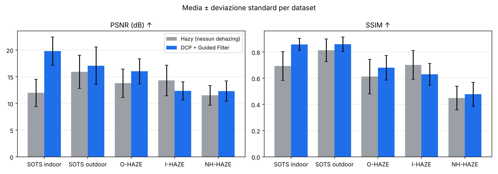

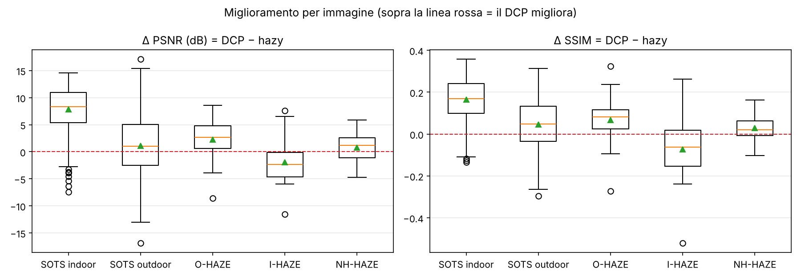

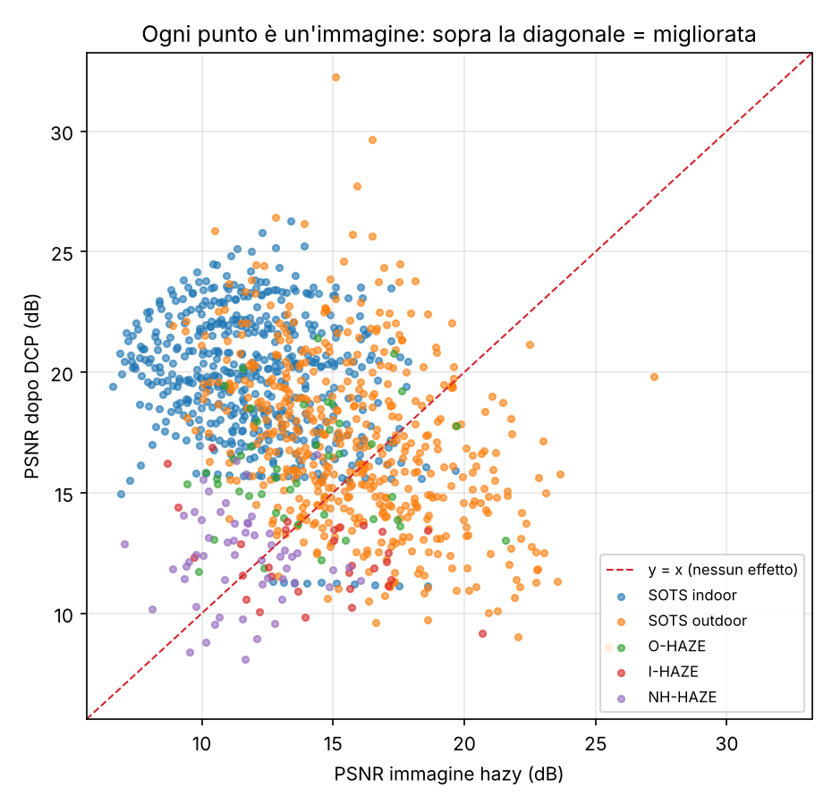

## Dettaglio per dataset

### SOTS indoor

500 coppie, nebbia sintetica, omogenea. Cartella dei risultati: `results/sots-indoor_p15_w0.95_t0.1_guided_brightest/`.

| Metrica | Media | Dev. std | Mediana | Min | Max |
|---|--:|--:|--:|--:|--:|
| PSNR hazy (dB) | 11.97 | 2.55 | 11.84 | 6.61 | 19.65 |
| PSNR DCP (dB) | 19.82 | 2.64 | 20.04 | 11.13 | 26.29 |
| SSIM hazy | 0.693 | 0.110 | 0.701 | 0.396 | 0.926 |
| SSIM DCP | 0.859 | 0.045 | 0.863 | 0.692 | 0.932 |

- In media il DCP migliora il PSNR di **7.84 dB** e migliora la SSIM di **0.165**; il PSNR migliora su **96%** delle immagini.
- Dati sintetici generati proprio con il modello di scattering atmosferico: è il caso favorevole per il DCP, utile come limite superiore delle prestazioni.

| | Immagine | PSNR hazy | PSNR DCP | Δ PSNR | SSIM DCP |
|---|---|--:|--:|--:|--:|
| migliore | `1431_8` | 8.82 | 23.42 | +14.60 | 0.842 |
| migliore | `1431_9` | 8.39 | 22.99 | +14.60 | 0.833 |
| migliore | `1444_9` | 7.48 | 22.06 | +14.58 | 0.775 |
| peggiore | `1416_1` | 18.60 | 11.13 | -7.47 | 0.791 |
| peggiore | `1416_2` | 17.51 | 11.15 | -6.36 | 0.790 |
| peggiore | `1416_3` | 16.59 | 11.18 | -5.41 | 0.789 |

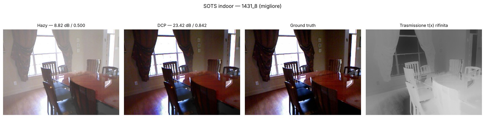

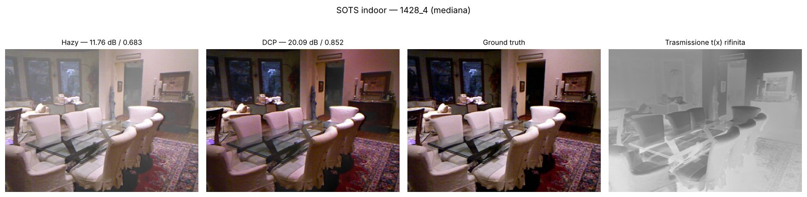

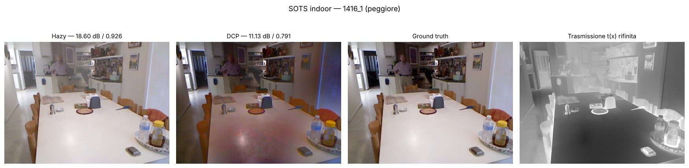

### SOTS outdoor

500 coppie, nebbia sintetica, omogenea. Cartella dei risultati: `results/sots-outdoor_p15_w0.95_t0.1_guided_brightest/`.

| Metrica | Media | Dev. std | Mediana | Min | Max |
|---|--:|--:|--:|--:|--:|
| PSNR hazy (dB) | 15.92 | 3.12 | 15.80 | 8.90 | 27.21 |
| PSNR DCP (dB) | 17.05 | 3.52 | 16.75 | 8.61 | 32.24 |
| SSIM hazy | 0.814 | 0.087 | 0.818 | 0.571 | 0.985 |
| SSIM DCP | 0.859 | 0.056 | 0.867 | 0.681 | 0.986 |

- In media il DCP migliora il PSNR di **1.13 dB** e migliora la SSIM di **0.045**; il PSNR migliora su **58%** delle immagini.
- Dati sintetici generati proprio con il modello di scattering atmosferico: è il caso favorevole per il DCP, utile come limite superiore delle prestazioni.

| | Immagine | PSNR hazy | PSNR DCP | Δ PSNR | SSIM DCP |
|---|---|--:|--:|--:|--:|
| migliore | `0171_0.85_0.12` | 15.10 | 32.24 | +17.14 | 0.986 |
| migliore | `0275_1_0.16` | 10.49 | 25.85 | +15.36 | 0.939 |
| migliore | `1055_0.95_0.2` | 12.80 | 26.41 | +13.61 | 0.963 |
| peggiore | `0337_0.8_0.08` | 25.49 | 8.61 | -16.88 | 0.684 |
| peggiore | `0066_1_0.08` | 22.04 | 9.04 | -13.00 | 0.706 |
| peggiore | `0022_0.8_0.08` | 23.56 | 11.31 | -12.24 | 0.755 |

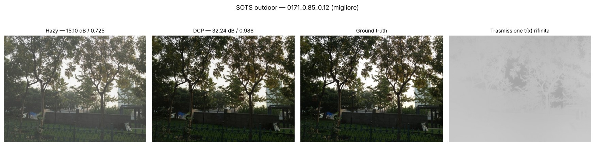

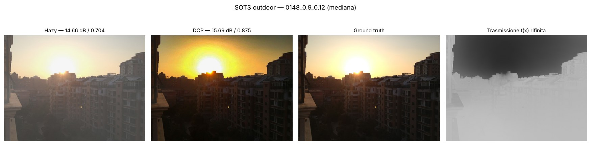

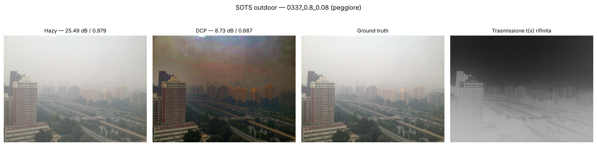

### O-HAZE

45 coppie, nebbia reale outdoor, omogenea. Cartella dei risultati: `results/o-haze_p15_w0.95_t0.1_guided_brightest/`.

| Metrica | Media | Dev. std | Mediana | Min | Max |
|---|--:|--:|--:|--:|--:|
| PSNR hazy (dB) | 13.79 | 2.68 | 13.61 | 9.44 | 21.58 |
| PSNR DCP (dB) | 16.01 | 2.36 | 15.63 | 11.75 | 21.41 |
| SSIM hazy | 0.612 | 0.131 | 0.634 | 0.330 | 0.881 |
| SSIM DCP | 0.680 | 0.094 | 0.687 | 0.516 | 0.883 |

- In media il DCP migliora il PSNR di **2.22 dB** e migliora la SSIM di **0.068**; il PSNR migliora su **78%** delle immagini.

| | Immagine | PSNR hazy | PSNR DCP | Δ PSNR | SSIM DCP |
|---|---|--:|--:|--:|--:|
| migliore | `06_outdoor` | 11.55 | 20.15 | +8.60 | 0.701 |
| migliore | `05_outdoor` | 10.86 | 19.46 | +8.59 | 0.654 |
| migliore | `18_outdoor` | 14.42 | 21.41 | +6.99 | 0.757 |
| peggiore | `04_outdoor` | 21.58 | 13.02 | -8.55 | 0.528 |
| peggiore | `41_outdoor` | 17.55 | 13.61 | -3.94 | 0.717 |
| peggiore | `32_outdoor` | 17.46 | 13.90 | -3.56 | 0.717 |

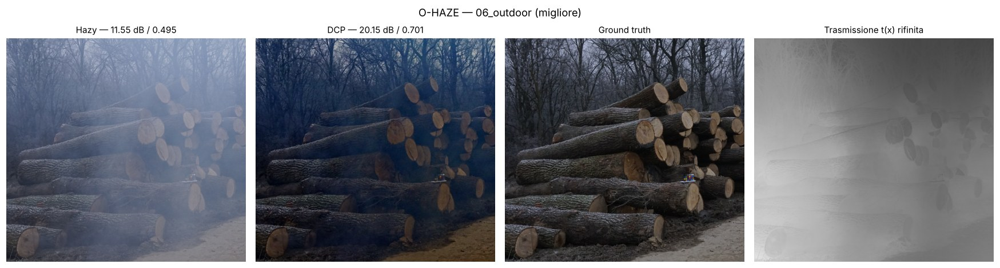

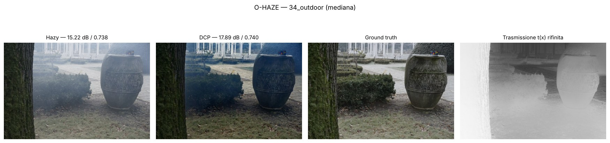

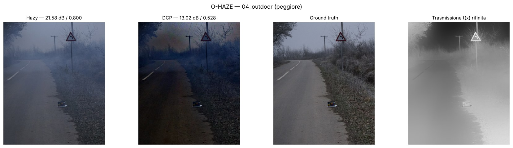

### I-HAZE

30 coppie, nebbia reale indoor, omogenea. Cartella dei risultati: `results/i-haze_p15_w0.95_t0.1_guided_brightest/`.

| Metrica | Media | Dev. std | Mediana | Min | Max |
|---|--:|--:|--:|--:|--:|
| PSNR hazy (dB) | 14.31 | 2.86 | 15.01 | 8.68 | 20.68 |
| PSNR DCP (dB) | 12.35 | 1.71 | 12.07 | 9.17 | 16.87 |
| SSIM hazy | 0.702 | 0.110 | 0.721 | 0.497 | 0.885 |
| SSIM DCP | 0.630 | 0.084 | 0.617 | 0.364 | 0.764 |

- In media il DCP peggiora il PSNR di **1.96 dB** e peggiora la SSIM di **0.072**; il PSNR migliora su **27%** delle immagini.
- Il PSNR medio scende sotto quello dell'immagine non elaborata: il prior qui non regge. Causa tipica: ampie superfici chiare o bianche (pareti, cielo) hanno un canale scuro alto anche senza nebbia, quindi la trasmissione viene sottostimata e la scena esce troppo scura (limite dichiarato da He et al.). Da provare: `--omega` più basso, `--t0` più alto, `--gamma` < 1.
- Scene indoor: luce artificiale e finestre sono spesso i punti più luminosi e la nebbia è leggera, quindi il margine di miglioramento è piccolo e l'errore del prior pesa di più.

| | Immagine | PSNR hazy | PSNR DCP | Δ PSNR | SSIM DCP |
|---|---|--:|--:|--:|--:|
| migliore | `18_indoor` | 8.68 | 16.24 | +7.56 | 0.691 |
| migliore | `11_indoor` | 10.38 | 16.87 | +6.49 | 0.764 |
| migliore | `04_indoor` | 9.11 | 14.41 | +5.30 | 0.611 |
| peggiore | `25_indoor` | 20.68 | 9.17 | -11.50 | 0.364 |
| peggiore | `24_indoor` | 17.11 | 11.15 | -5.96 | 0.568 |
| peggiore | `10_indoor` | 17.22 | 11.41 | -5.81 | 0.618 |

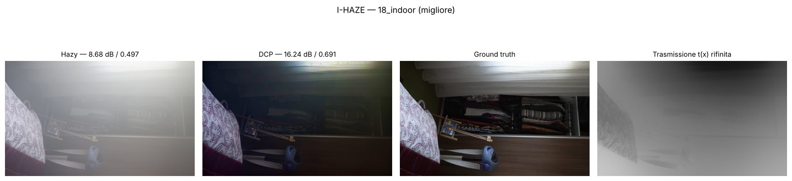

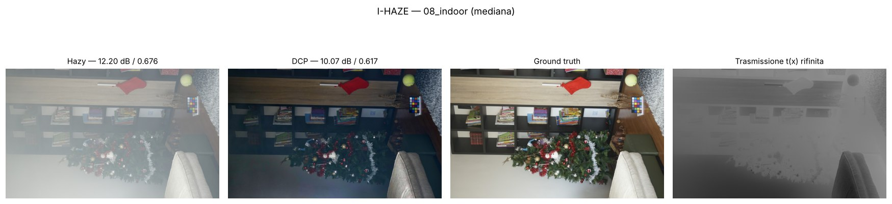

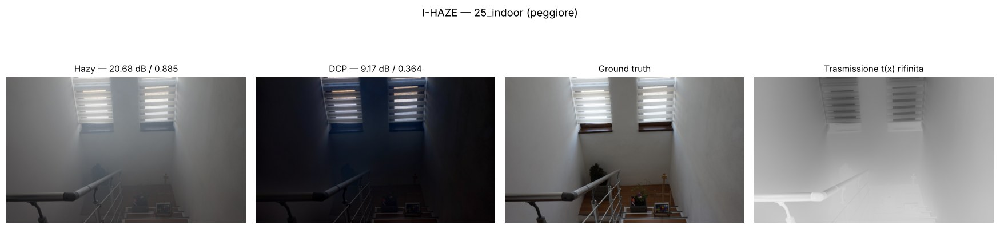

### NH-HAZE

55 coppie, nebbia reale, NON omogenea. Cartella dei risultati: `results/nh-haze_p15_w0.95_t0.1_guided_brightest/`.

| Metrica | Media | Dev. std | Mediana | Min | Max |
|---|--:|--:|--:|--:|--:|
| PSNR hazy (dB) | 11.52 | 1.84 | 11.54 | 7.05 | 16.05 |
| PSNR DCP (dB) | 12.29 | 1.92 | 12.37 | 8.09 | 16.59 |
| SSIM hazy | 0.448 | 0.091 | 0.439 | 0.243 | 0.678 |
| SSIM DCP | 0.478 | 0.092 | 0.479 | 0.270 | 0.661 |

- In media il DCP migliora il PSNR di **0.77 dB** e migliora la SSIM di **0.030**; il PSNR migliora su **58%** delle immagini.
- Nebbia non omogenea: il modello assume una sola airlight A e una nebbia che dipende solo dalla profondità, quindi un miglioramento limitato è il comportamento atteso.

| | Immagine | PSNR hazy | PSNR DCP | Δ PSNR | SSIM DCP |
|---|---|--:|--:|--:|--:|
| migliore | `47` | 7.05 | 12.90 | +5.85 | 0.443 |
| migliore | `51` | 10.04 | 15.54 | +5.49 | 0.500 |
| migliore | `01` | 11.31 | 16.35 | +5.04 | 0.635 |
| peggiore | `16` | 16.05 | 11.36 | -4.69 | 0.612 |
| peggiore | `31` | 14.84 | 11.10 | -3.74 | 0.413 |
| peggiore | `14` | 15.59 | 11.92 | -3.67 | 0.536 |

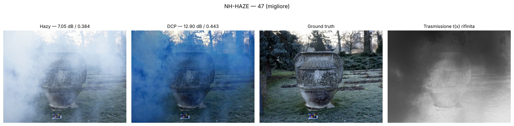

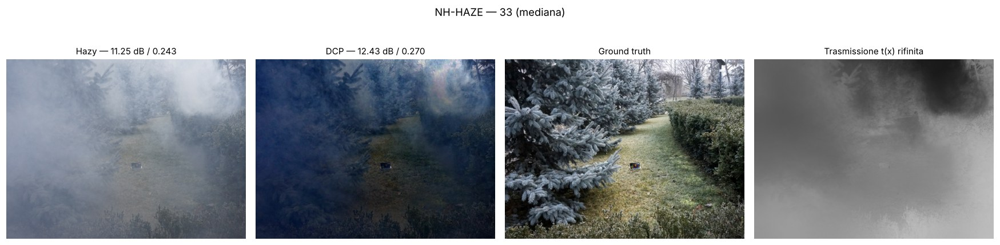

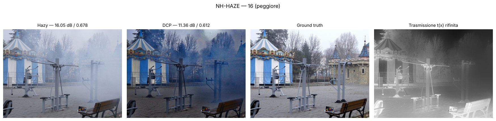

## Ablazioni

Non ci sono ancora run con parametri diversi dal default. Esempio (PowerShell) per l'ablazione di ω su SOTS indoor:

```powershell
foreach ($w in 0.8, 0.85, 0.9, 1.0) { python scripts/evaluate.py --dataset sots-indoor --omega $w }
python scripts/make_report.py
```

Ogni run finisce in una cartella diversa e questo report lo include da solo, con tabella e grafico.
